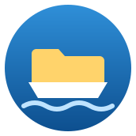

# Lautta



[](https://sonarcloud.io/summary/new_code?id=muhnschein_lautta)[](https://sonarcloud.io/summary/new_code?id=muhnschein_lautta)[](https://sonarcloud.io/summary/new_code?id=muhnschein_lautta)[](https://sonarcloud.io/summary/new_code?id=muhnschein_lautta)

## Overview

Lautta (Finnish: ferry) is a file manager for Sailfish OS. It is two things:

- **A Jolla Store app you can use today.** Sandboxed, within the store's
  rules, no network access of its own.
- **A showcase** of what Sailfish apps could do if the platform offered
  network locations, the way iOS Files does. [netvfs](https://github.com/muhnschein/netvfs)
  is a sketch of such a platform service. With it installed, Lautta browses
  servers as if they were folders on the phone.

Lautta is a Rust program with a Silica UI, in one process. It implements no
network protocol: everything remote goes through netvfs.

## With and without netvfs

| | Jolla Store only | With netvfs |
|---|:---:|:---:|
| Documents, Downloads, Pictures, Music, Videos, Android folders | ✓ | ✓ |
| Memory cards and USB drives the system has mounted | ✓ | ✓ |
| Copy, move, rename, compress, favourites, recents, search, Trash | ✓ | ✓ |
| Viewers for images, video, music, PDF, text, code, Markdown | ✓ | ✓ |
| Thumbnails for photos, videos, PDFs and text files | ✓ | ✓ |
| *Save to Lautta* in the share menu | ✓ | ✓ |
| SFTP and SMB servers from *Settings → Accounts* | ✗ | ✓ |
| Servers typed in by hand or found nearby | ✗ | ✓ |
| Copy and move between phone and servers, in a queue that survives a restart | ✗ | ✓ |
| Remote media streamed in place, remote files opened in other apps | ✗ | ✓ |
| Mount and unmount memory cards and USB drives, see locked encrypted ones | ✗ | ✓ |
| *Settings → Storage* one tap away | ✗ | ✓ |

Lautta never sees a password or a key. Accounts live in Settings; netvfs asks
once whether Lautta may use them. Without netvfs, nothing of it shows.

## Limitations

- No network protocol in the app, ever.
- Only the folders the Sailfish sandbox allows: no root, no system files.
- Nothing runs once the app is closed.
- No OpenRepos/Chum.

## Building

A device package, built in the Sailfish OS SDK image (needs Docker):

```
$ git clone https://github.com/muhnschein/lautta.git
$ cd lautta
$ export SDK_IMAGE=mirror.gcr.io/coderus/sailfishos-platform-sdk-aarch64:5.2.0.15
$ export TARGET=SailfishOS-5.2.0.15-aarch64
$ make rpm
```

Everything else needs no phone and no netvfs; a fake bridge stands in for it:

```
# Host dependencies on Ubuntu 24.04: Qt 5, lupdate, the pinned Rust.
$ ./tools/ci/install-host-deps.sh nextest

# What CI runs on the host: rustfmt, translations, clippy, tests, QML tests.
$ make check
```

## Attributions

* [Jolla](https://github.com/sailfishos), for publishing
  [jolla-gallery](https://github.com/sailfishos/jolla-gallery) and
  [sailfish-components-gallery](https://github.com/sailfishos/sailfish-components-gallery)
  under the BSD licence. Lautta's image viewer is adapted from them.
* [JetBrains](https://github.com/JetBrains/intellij-community), for the file
  type icons of IntelliJ.
* [hayro](https://github.com/LaurenzV/hayro), for reading PDFs in pure Rust.

## License

Licensed LGPL-2.1-or-later. The image viewer files adapted from Jolla are
BSD-3-Clause, the JetBrains icons Apache-2.0; each file says which.

Copyright © Lautta contributors.
