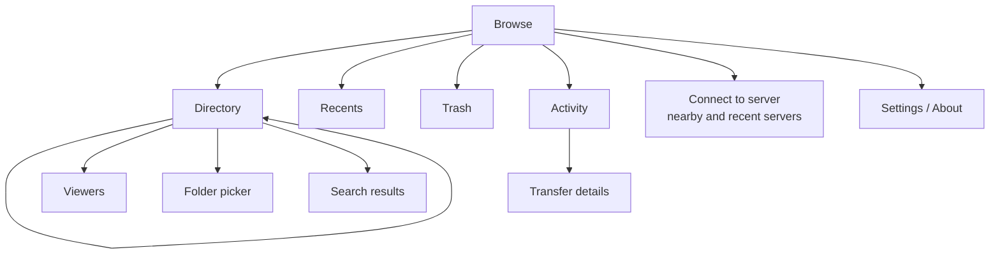

# Lautta — SPEC

*Lautta* (Finnish: ferry) is a working title. `harbour-lautta`, `org.netvfs` and
`lautta` below are placeholders and can be renamed in one pass.

Status: draft 2. Target: Sailfish OS 5.2+, aarch64 only, distributed through Jolla Harbour
only. Remote locations come from netvfs v2 through its bridge (`netvfs/SPEC.md` §8a,
requirement IDs `XB-*`) when that is installed; the app is complete and Harbour-compliant
without it.

Requirement prefixes: `HBR` Harbour compliance, `ARC` architecture, `RS` Rust,
`NVB` netvfs bridge integration, `LOC` locations, `BRW` browsing, `OPS` file operations,
`XFR` transfers, `PRV` preview, `SRC` search, `ORG` favourites/recents, `INT` system
integration, `UI` interface, `SEC` security,
`PRF` performance, `DAT` persistence, `TST` testing, `PKG` packaging. "Must" is a
requirement, "should" a default that may be revisited with a recorded reason, "may"
optional.

## 0. Changes since draft 1

| Draft 1 | Draft 2 |
|---|---|
| OpenRepos/Chum, unsandboxed, Harbour collisions accepted | Harbour only, Harbour-compliant by default, sandboxed with the smallest permission set |
| aarch64 + armv7hl + emulator | aarch64 only |
| C++ app linking libnetvfs | Rust app; never links netvfs |
| `lauttad` daemon, systemd unit, D-Bus service, transfer-engine plugin | single process, no daemon, no system integration files outside Harbour's paths |
| Whole host file system, Root location | user folders and removable media only |
| Built-in protocol stack via netvfs plugins in-process | remote access only through the netvfs bridge, over a socket in the app's own data folder, with file descriptors for local data |
| Accounts created in-app with netvfs QML | account management handed off to Settings via the bridge |
| Share plugin via transfer-engine | `ShareProvider` (Sailfish.Share) share target |

## 1. Summary

A file manager for Sailfish OS in the spirit of the iOS Files app with the transfer
capabilities of Transmit or Cyberduck. On its own it manages the user's files: Documents,
Downloads, Pictures, Music, Videos, Public, the Android storage folders Sailjail exposes, SD
cards and USB drives. When netvfs v2 with its bridge is installed, the same app also
browses every SFTP and SMB server configured in Settings → Accounts.
Those servers become ordinary locations: browse, preview, stream, open in other apps, copy
and move between any two of them, with a persistent, resumable queue.

The app is a Rust program with a Silica QML UI. It is a single sandboxed process.

## 2. Goals, non-goals, principles

### 2.1 Goals

1. Pass Harbour intake with no exceptions, warnings only where unavoidable and documented
   (§3).
2. The everyday features of Harbour File Browser inside the same sandbox (Appendix A).
3. When netvfs v2 is present: remote locations as first-class as local ones, with a
   desktop-class transfer engine.
4. Open remote files in other apps; preview and play media without leaving the app.
5. Never lose data; never fail open on security; never show the user a decision the
   platform could make safely.

### 2.2 Non-goals

- The host file system outside the user's folders and removable media. That is the
  platform's business.
- Any network protocol implemented in the app. All remote access goes through netvfs.
- Background operation after the app is closed. No daemons, no services.
- Root mode, account creation inside the app, share links, cloud OAuth providers.
- Any distribution channel other than Harbour; any architecture other than aarch64.

### 2.3 Principles

- Minimal permissions. Every permission in the desktop file has a feature that needs it
  and a line in §3.3 saying which.
- The sandbox is a feature. The app never asks netvfs to touch local paths on its behalf;
  it hands over file descriptors it opened itself (NVB-9).
- Silica first. Pulley menus, remorse timers, attached pages, cover actions.
- Latency is a feature. Cached listings show instantly; transfers never make browsing
  wait.
- One engine, many locations. Capability flags, not provider names, decide what the UI
  offers.

## 3. Platform and Harbour compliance

### 3.1 Target

| Item | Value |
|---|---|
| OS | Sailfish OS 5.2 or later |
| Architecture | aarch64 only (`ExclusiveArch: aarch64`) |
| UI | Qt 5.6, Silica, QML |
| Logic | Rust (§6), edition and MSRV fixed to the rustc in the 5.2 SDK target |
| Build | Sailfish SDK (`sfdk`), cargo inside the scratchbox2 target |
| Package | `harbour-lautta-<version>-<release>.aarch64.rpm` |
| Distribution | Jolla Harbour only |
| Licence | to decide (§24); clean-room, no Harbour File Browser code reuse |

### 3.2 Harbour rules the design depends on

Taken from `sailfishos/sdk-harbour-rpmvalidator` as of commit `7dd7dd5` (2026-09-10).
CI runs that validator on every package (TST-7); this table is a summary, the validator
is the authority.

- HBR-1: Package name `harbour-lautta`; files only at `/usr/bin/harbour-lautta`,
  `/usr/share/harbour-lautta/**`, `/usr/share/applications/harbour-lautta.desktop`, and
  the icon paths. No systemd units, D-Bus service files, account files, transfer-engine
  plugins, or files in `/etc`.
- HBR-2: Dynamic libraries only from the allowed list. The app links exactly:
  `libc`, `libm`, `libpthread`, `libdl`, `librt`, `libgcc_s`, `libstdc++` (Qt glue),
  `libQt5Core`, `libQt5Gui`, `libQt5Qml`, `libQt5Quick`, `libQt5Multimedia`,
  `libsailfishapp`, `libsqlite3`, `libz`, `liblzma`, `libbz2`. No other `.so`, no bundled
  `.so` files (everything else is statically linked Rust), no RPATH.
- HBR-3: QML imports only from the allowed list: `QtQuick 2.6`, `QtQml.Models 2.2`,
  `Sailfish.Silica 1.0`, `Sailfish.Share 1.0`, `Sailfish.Pickers 1.0`,
  `Nemo.Notifications 1.0`, `Nemo.KeepAlive 1.2`, `Nemo.Thumbnailer 1.0`,
  `Nemo.Configuration 1.0`, `QtMultimedia 5.6`. App-private QML modules live under
  `/usr/share/harbour-lautta/qml` and use a non-reserved URI (`Lautta.*`).
- HBR-4: The binary exports `main` (the validator errors otherwise for Silica apps) and
  links `__libc_start_main@GLIBC_2.34` (expected version on aarch64). The desktop file
  sets `X-Nemo-Application-Type=no-invoker`, so Sailjail runs `/usr/bin/harbour-lautta`
  itself: the netvfs bridge only serves a peer whose executable is the registered one
  (netvfs XB-5), and under the silica-qt5 booster the process's executable is the
  booster. Sailjail's `private-bin` (HBR-7) runs a *copy* of the binary from a tmpfs, so
  the bridge must compare the executable by content, not by inode (netvfs XB-5); with a
  netvfs that compares inodes only, the app runs standalone when started from the app grid.
  The validator's resulting warning is documented in `doc/harbour-warnings.md`.
- HBR-5: `[X-Sailjail]` uses only `Permissions`, `OrganizationName`, `ApplicationName`,
  `ExecDBus`. `OrganizationName` must not be `com.jolla` or `org.sailfishos`.
- HBR-6: No setuid/setgid bits, no debug info in the package, no source-control files.
- HBR-7: The app must not spawn other programs. Sailjail's `private-bin` only provides
  the app's own binary, so the design contains no subprocesses at all.

### 3.3 Sandbox profile

```ini
[X-Sailjail]
OrganizationName=org.netvfs
ApplicationName=lautta
Permissions=UserDirs;RemovableMedia;Audio
ExecDBus=harbour-lautta
```

| Permission | Why | What it grants (sailjail-permissions) |
|---|---|---|
| `UserDirs` | the user's files | `~/Documents`, `~/Downloads`, `~/Pictures`, `~/Music`, `~/Playlists`, `~/Videos`, `~/Public`, and `~/android_storage/{Documents,Download,Pictures,DCIM,Music,Podcasts,Movies}` |
| `RemovableMedia` | SD cards and USB drives | `/run/media` (via `ignore disable-mnt`), listening to UDisks2 signals |
| `Audio` | sound in audio/video preview | PulseAudio, GStreamer cache |

Not requested, on purpose: `Internet` (the app never opens network sockets; netvfs does —
see PRV-9 for the one feature that was redesigned to avoid it), `Accounts` and `Secrets`
(credentials stay inside netvfs), `MediaIndexing` (optional later, SRC-5), `Compatibility`.

Implicit: `~/.local/share/org.netvfs/lautta`, `~/.cache/org.netvfs/lautta`,
`~/.config/org.netvfs/lautta`, and ownership of D-Bus name `org.netvfs.lautta` (used for
notification actions and `ExecDBus` activation).

What the app sees of the file system (firejail `whitelist`): a tmpfs on `$HOME` with every
granted folder above, and the app's own folders, bind-mounted onto it one by one. So no
folder is on `$HOME`'s device, and `rename(2)` between two of them fails with `EXDEV` even
when both live on the same ext4: moves between folders are copies (OPS-4), and so is a
move into the *Trash* in the app's data folder (OPS-8). `/run/media` is the host's (`ignore
disable-mnt`); the sandbox has its own mount namespace, in which an inotify watch on the
media folder can miss a mount, so volumes are also rescanned (LOC-3).

### 3.4 Two modes

| | Standalone (Harbour default) | With netvfs v2 bridge |
|---|---|---|
| Locations | user folders, Android folders, removable media, archives | + every netvfs account with *Files* enabled, ad-hoc servers, Nearby |
| Network | none | none in the app; the bridge does it |
| Credentials | none | never seen by the app for saved accounts; typed-in secrets for ad-hoc servers are passed once and wiped |
| UI differences | no *Servers* section, no *Connect to server* | full |
| Detection | socket absent | socket present at NVB-1 path and handshake succeeds |

The app must be useful and polished in standalone mode. Harbour reviewers will mostly
see that mode; the store description mentions network locations neutrally ("works with
network locations provided by netvfs, if installed") and never as the main feature
(risk R-1).

## 4. Glossary

| Term | Meaning |
|---|---|
| Location | Something browsable with a root: a user folder, an Android folder, a removable volume, a netvfs account, an ad-hoc server, an archive. Stable `locationId`. |
| Provider | Rust implementation behind locations: `local`, `netvfs`, `archive`. |
| Bridge | netvfs's `netvfs-bridge` process serving this app over a unix socket (netvfs XB-*). |
| Account | A netvfs account with the *Files* service enabled, as exposed by the bridge. |
| Ad-hoc location | A server opened via *Connect to server*; lives in the bridge for this app only. |
| Operation | A user-level action (copy 37 items to X), planned into steps. |
| Transfer | An operation that moves bytes; persisted in the queue. |
| Working copy | A local copy of a remote file opened in another app; it expires (PRV-6). |

## 5. Architecture

### 5.1 Overview

```mermaid
flowchart LR
  subgraph APP["harbour-lautta (sandboxed, one process)"]
    QML[Silica QML] --> QT[Qt glue: qmetaobject-rs<br/>models, QObjects]
    QT --> CORE[lautta-core (Rust)]
    CORE --> LP[local provider]
    CORE --> AP[archive provider]
    CORE --> NP[netvfs provider<br/>zbus p2p client]
    CORE --> DB[(SQLite: queue, caches,<br/>prefs, recents)]
  end
  NP <-- "unix socket in app data dir<br/>p2p D-Bus + fd passing" --> BR[netvfs-bridge<br/>(not part of this app)]
  BR --> NV[(libnetvfs v2 + backends)]
  NV <--> S[(SFTP / SMB servers)]
  LP --> FS[(user folders, /run/media)]
```

- ARC-1: One process. No helper binaries (HBR-7), no daemon (HBR-1). Work that must
  outlive a page lives in `lautta-core`; work that must outlive the process is persisted
  and resumed at the next start (XFR-11).
- ARC-2: `lautta-core` has no Qt dependency. It is testable on the host with
  `cargo test`, including against a fake bridge (TST-2).
- ARC-3: `lautta-qt` exposes core to QML with `qmetaobject-rs`: list models, QObject
  facades, image providers. It contains no business logic.
- ARC-4: Providers implement one async trait (Appendix B). The UI and the operation
  planner see only `Provider` + `Capabilities`; there are no provider-specific branches
  above the provider layer.

### 5.2 Threads and runtimes

- ARC-5: The Qt GUI thread owns every QObject and model. Core never touches QObjects;
  results return through `qmetaobject::queued_callback` closures.
- ARC-6: A tokio multi-thread runtime with 2 worker threads runs orchestration, the
  bridge client and the transfer scheduler. Local file system calls run on
  `spawn_blocking` with a semaphore of 4 (a slow SD card must not starve the runtime).
- ARC-7: CPU-heavy work (thumbnail decoding, hashing, decompression) runs on
  `spawn_blocking` behind a separate semaphore of `max(1, cores − 2)`.
- ARC-8: Sorting and filtering of listings run in core (off the GUI thread) and are
  delivered as index permutations plus diffs, so the GUI thread only applies
  `beginInsertRows`/`dataChanged` batches.

### 5.3 Core components

| Component | Responsibility |
|---|---|
| `LocationRegistry` | user folders that exist and are readable, removable volumes (UDisks2 signals + `/run/media/$USER`), bridge locations, archives |
| `BridgeClient` | socket discovery, handshake, consent state, reconnect, request/response and job plumbing (§7) |
| `Scheduler` | per-location lanes (interactive / bulk / stream) mapped to bridge lane hints or local semaphores |
| `Planner` | expands operations into steps, scans, detects conflicts |
| `TransferQueue` | persistent queue and history in SQLite, resume bookkeeping |
| `DirCache` | memory LRU + SQLite listing cache, stale-while-revalidate |
| `Thumbs` | local image and video thumbnails via `Nemo.Thumbnailer`; remote images and PDFs decoded in Rust |
| `MediaSource` | random-access byte source for the player (PRV-9) |
| `WorkingCopies` | copies of remote files opened in other apps, expiry (PRV-6) |
| `Trash` | app-private *Trash* for this device's folders |
| `Questions` | blocking prompts (conflicts, ad-hoc identity, keyboard-interactive) |

## 6. Rust

### 6.1 Decision record

Rust was chosen unless a strong reason spoke against it. The candidates were checked:

| Concern | Finding | Verdict |
|---|---|---|
| Qt 5.6 bindings | `qmetaobject-rs` supports Qt ≥ 5.6 (build script refuses older), is maintained (2026 commits), and has been used for Silica apps | fine; pin a commit |
| Toolchain in the SDK | Sailfish packages rustc/cargo with scratchbox2 patches (`sailfishos/rust`, tags 1.75 and 1.95); the 5.2 target ships 1.75 | MSRV 1.95; until a target ships it, the binary is cross-built with host cargo against the SDK's gcc, Qt and sysroot (RS-6) |
| Harbour ELF checks | Rust binaries link only libc/libm/libpthread/libdl/librt/libgcc_s; need an exported `main` | fine with RS-3 |
| netvfs is C++/Qt | the app no longer links netvfs (Harbour forbids its dependencies); the boundary is a socket protocol | Rust is no worse than C++ here |
| C++ glue needed | SailfishApp bootstrap, `QMediaPlayer` with a `QIODevice`; both small, via the `cpp` crate inside `lautta-qt` | acceptable, contained |
| Booster | mapplauncherd `silica-qt5` booster loads the binary as a PIE and calls `main` | needs device verification (§24.1), fallback in RS-3 |

No strong reason against was found. Residual risks: booster compatibility and crate MSRV
against the target rustc.

### 6.2 Requirements

- RS-1: Cargo workspace: `lautta-core` (no Qt), `lautta-qt` (qmetaobject-rs, `cpp`),
  `lautta-bridge-proto` (bridge types and the D-Bus interface, shared with the fake
  bridge used in tests), `harbour-lautta` (binary).
- RS-2: Native linkage only to HBR-2 libraries. `cargo-deny` enforces an allow-list of
  crates with `links =` keys and of licences. Preferred pure-Rust backends: `zbus`
  (no libdbus), `miniz_oxide` via `flate2`, `zip`, `tar`, `image` (jpeg, png, gif, webp),
  `kamadak-exif`, `pulldown-cmark`, `syntect` with `fancy-regex` (PRV-13), `notify`
  (inotify), `rustix` (renameat2, statx, copy_file_range). `rusqlite` links the system `libsqlite3.so.0`; `xz2` and `bzip2` link
  the system `liblzma`/`libbz2`. zstd, if used, is linked statically.
- RS-3: Binary: `#![no_main]`, `#[no_mangle] pub extern "C" fn main(argc, argv)`, linked
  with `-Wl,--export-dynamic-symbol=main`, PIE. Arguments come from `main`'s parameters,
  not `std::env::args`. The app starts directly (`no-invoker`, HBR-4), not through
  the booster.
- RS-4: `panic = "abort"` in release. Every closure invoked from C++ is a thin trampoline
  that cannot unwind.
- RS-5: `unsafe` is allowed only in `lautta-qt` (FFI) and in a single `sys` module of
  `lautta-core` (fd passing, `statx`, `renameat2`). `#![forbid(unsafe_code)]` elsewhere.
- RS-6: `Cargo.lock` is committed. The binary is cross-built with the pinned host
  toolchain against the SDK target's gcc, Qt and sysroot, lifted from the pinned SDK
  image (`tools/ci/lift-sdk.sh`, `cross-build.sh`); the spec installs it from
  `prebuilt/` and `mb2` never touches the network. Once an SDK target ships rustc
  1.95, the spec builds it again with vendored crates.
- RS-7: Release profile: `lto = "fat"`, `codegen-units = 1`, `opt-level = 3`, `strip =
  "symbols"` (the validator rejects debug info). Binary size budget: ≤ 20 MB stripped.
- RS-8: Error model: `lautta_core::Error` mirrors the netvfs v2 taxonomy one-to-one
  (`AuthFailed`, `ServerIdentityChanged`, `NotFound`, `Locked`, …) plus local `io`
  mappings, so the UI has one message table (§20) for every provider.
- RS-9: Third-party data built into the binary, with its licence: `syntect` 5.3 (MIT,
  © Tristan Hume, Keith Hall, Google Inc and contributors) embeds its default grammar
  set (`default_newlines.packdump`, PRV-13), made from the Sublime Text grammars of
  github.com/sublimehq/Packages, which that repository licenses as "Permission to
  copy, use, modify, sell and distribute this software is granted. This software is
  provided "as is" without express or implied warranty, and with no claim as to its
  suitability for any purpose", except files that carry a licence of their own. The
  set holds Plain Text, ASP, ActionScript, AppleScript, Batch File, NAnt, C#, C, C++,
  CSS, Clojure, D, Diff, Erlang, Go, Graphviz, Groovy, HTML (and its ASP, Erlang, JSP,
  Rails, Tcl variants), Haskell, Java, JavaDoc, Java Properties, JSON, JavaScript,
  BibTeX, LaTeX, TeX, Lisp, Lua, Makefile, Markdown, MultiMarkdown, MATLAB, OCaml,
  Objective-C(++), PHP, Pascal, Perl, Python, R, Rd, Ruby (Haml, Rails), regular
  expressions, reStructuredText, Rust, SQL, Scala, shell (bash), Tcl, Textile, XML and
  YAML. Crates it links in that the app did not have: `fancy-regex`, `bincode` 1 (MIT),
  `regex-automata`, `regex-syntax`, `bit-set`, `bit-vec`, `fnv` (MIT or Apache-2.0).

## 7. netvfs bridge integration

The bridge is specified normatively in `netvfs/SPEC.md` §8a (XB-*). This section states
what the app does.

- NVB-1: Discovery: the app checks for the socket
  `~/.local/share/org.netvfs/lautta/netvfs/bridge.sock` at start, when returning to the
  foreground, and when inotify reports it created. Absent socket → standalone mode
  without any message. The app never creates that directory or file.
- NVB-2: Connection: peer-to-peer D-Bus (`zbus`, unix socket transport with fd passing),
  interface `org.netvfs.Bridge1`. First call `Hello(clientVersion)`, which answers the
  bridge's version.
- NVB-3: Consent: until the bridge reports consent `granted`, the *Servers* section shows
  one row "Allow access in the notification from netvfs" with *Ask again*
  (`RequestConsent`). `denied` hides the section and shows the reason in *About*.
- NVB-4: Locations: `ListLocations` and `LocationsChanged` populate *Servers* (accounts
  and this app's ad-hoc servers) and *Nearby* (`Discover`). Attention states from netvfs
  (`auth-failed`, `server-identity-changed`) show as warnings. A server row's status (on
  the right, §15.2) tells only how its connection stands, from the `state` and
  `stateError` netvfs lists for each location (netvfs
  XB-10, XB-12; every `LocationsChanged` lists again and the row changes in place), as
  one icon and no text: connected is a glowing dot, connecting a busy indicator, not
  connected an empty ring (never used, closed when idle or dropped; also a recent ad-hoc
  server), could not connect a ring in the error colour, and a warning icon in the error
  colour for a sign-in or identity that needs the user (`stateError` `AuthFailed` or
  `ServerIdentityChanged`, or an attention, which comes first). A bridge that reports
  no state gets no icon rather than a wrong one. No protocol or host is shown. The
  connection state is not the location's status: a server that is not connected stays
  browsable, and opening it connects.
- NVB-5: Account management is handed off: *Add server* → `AddAccount(provider)`;
  *Edit server*, *Update sign-in*, *Review server identity* → `OpenAccountSettings(id)`.
  The bridge opens Settings; the app never edits accounts, pins or secrets, and never
  opens or closes connections (no *Disconnect*).
- NVB-6: Ad-hoc servers: *Connect to server* collects an `sftp://` or `smb://` URL and,
  when needed, a secret, and calls `ConnectAdHoc`. The secret buffer is zeroized
  (`zeroize`) immediately after the call. Identity prompts for ad-hoc servers and the
  consent to an unencrypted connection (SMB's `legacy` and `guest` profiles) arrive as
  `Question` signals and are answered in the app; for accounts they never are (NVB-5).
- NVB-7: Requests: namespace operations, stat, list (batched signals), handles, server
  copy, checksums and space info map one-to-one to bridge methods. Every request carries
  a lane hint (`interactive`, `bulk`, `stream`); the bridge owns connection pools.
- NVB-8: Names and paths cross the bridge as byte strings (`ay`), never `s`, because
  netvfs names may contain bytes that are not UTF-8 (netvfs XC-4) and D-Bus strings must
  be valid UTF-8. In Rust they are a `RemotePath(Vec<u8>)` newtype; display uses lossy
  decoding with a badge (BRW-1).
- NVB-9: Local data never travels by path. For uploads the app opens the local file
  read-only and passes the fd; for downloads it creates the destination temporary file
  (O_EXCL, NVB-11 naming) and passes a writable fd; for streams from archives or
  compressors it passes one end of a pipe. The bridge must use `pread`/`pwrite` at
  explicit offsets (netvfs XB-11), so the app may keep using its own copy of the fd for
  size checks.
- NVB-10: Jobs (`Upload`, `Download`, `CopyAcross`, `RemoveTree`, `Walk`) report
  `JobProgress` (≤ 4 Hz) and `JobFinished`. The app persists job intent in its queue before
  starting a job, so a crash or bridge restart never loses track of a transfer.
- NVB-11: Temporary names: `.<name>.lautta-<shortid>.part` for both local and remote
  destinations, passed to the bridge as the upload target; the final rename is a separate
  `Rename(NoReplace or Replace)` call. Backends reporting `AtomicPut` are written
  directly.
- NVB-12: Failure handling: socket EOF or `ConnectionLost` → all bridge locations show
  *Connecting…* (NVB-4); the app reconnects with backoff (1, 2, 4, 8 s, then 15 s) while in the
  foreground; running transfers become *waiting* and resume (XFR-12). The bridge cancels
  jobs of a disconnected client itself (netvfs XB-13).
- NVB-13: Features: after `Hello` the app asks `GetFeatures` (netvfs XB-19) and offers
  what depends on an optional part of the interface only while the bridge names it:
  `storage-settings` → *Open Storage settings* (LOC-3); `drives` → memory cards and USB
  drives that are not mounted, *Mount* and *Unmount* (LOC-3). Names the app does not know are
  ignored. A bridge without the method (`UnknownMethod`) names none, and the app behaves
  as with a bridge that offers nothing more; only a lost connection fails the handshake.
  The features are asked again on every connection.

## 8. Locations

- LOC-1: User folders: Documents, Downloads, Pictures, Music, Videos, Public, Playlists;
  each shown only if it exists and is readable. There is no "Home" or "Root" location
  (the sandbox would show an incomplete tree, which the old File Browser had to explain).
- LOC-2: Android storage: one *Android* group listing the exposed subfolders (Documents,
  Download, Pictures, DCIM, Music, Podcasts, Movies) that exist.
- LOC-3: Removable volumes: the readable, non-hidden folders `/run/media/<user>/<label or
  UUID>` (`<user>` is `$USER`, the home folder's name when that is unset). They appear and
  disappear live: an inotify watch on the media folder (on its nearest existing parent
  until it exists) runs for the app's lifetime, and Browse rescans whenever it refreshes,
  also when the app comes back to the foreground, for mounts the watch missed (§3.3). The
  app does not use UDisks2 itself: the sandbox may not mount, unmount or format. While the
  bridge has the `drives` feature (NVB-13) it lists the memory cards and USB drives it can
  mount (`ListDrives`, netvfs XB-20, also without the consent, followed by
  `DrivesChanged`): one that is not mounted is a dimmed *Volumes* row with its size and
  an empty ring on the right (as tall as a mounted volume), named and placed (BRW-12) as
  the volume it becomes, by the folder UDisks2 mounts it on (label, else UUID, else
  `disk`). Tapping it, or its *Mount*, has the
  bridge mount it (`Mount`, as Settings › Storage does, without a question) and opens the
  volume once the sandbox shows its folder (up to 2 s; otherwise "not found", naming it). A mounted volume of
  such a drive has *Unmount* (`Unmount`) and the glowing dot of a connected server on the
  right; a failure (busy, not allowed) is told with the volume's name. A volume the
  bridge does not mount has no icon: it is there because it is mounted. A drive that is
  mounted where the sandbox does not see it is not shown.
  Without the feature (older netvfs, standalone) volumes are only the mounted ones and
  have neither entry. *Open Storage settings* asks the bridge to open
  Settings › Storage (`OpenStorageSettings`, netvfs XB-15) and is offered only while it
  has the `storage-settings` feature (NVB-13): the sandbox can open no `settings:` URL
  (no handler, "schema not supported") and may not call the Settings app's D-Bus service
  itself (verify the Storage page, §24.1). Transfers to a vanishing volume pause with "Insert the card to
  continue".
- LOC-4: netvfs accounts and ad-hoc servers (NVB-4, NVB-6).
- LOC-5: Archives opened as read-only locations (PRV-11).
- LOC-6: Nearby servers from the bridge's discovery; tapping prefills *Connect to
  server*; nothing connects automatically. Discovery runs while Browse is shown. netvfs
  forgets its results when discovery stops and reports an empty list right after a
  restart, so for 3 s after each start the servers already shown stay and new ones join
  them; after that the bridge's list is shown as it is.
- LOC-7: Internal URI `lautta://<locationId>/<path>` (path bytes percent-encoded).
  `locationId`: `user-documents`, …, `android-dcim`, `vol-<uuid>`, `nv-<bridge id>`,
  `arc-<hash>`. Display/copy address: `file://` for local, the netvfs URL from the bridge
  for remote (secrets never included).

## 9. Browsing

- BRW-1: `DirectoryModel` roles: name (lossy display), nameIsLossy, type, isDir (follows
  symlink target type when known), isSymlink, size, modified, created, mode, owner,
  group, flags (hidden, readonly), mimeType (extension, plus magic sniffing for local
  files), icon, thumbnail, selected, transferState.
- BRW-2: Sorting: natural, case-insensitive name order (a natural-sort comparator over
  lowercased NFC text with a byte-order tiebreak; full ICU collation is not worth its size
  in the binary), size, modified, type; folders first toggle; stable.
- BRW-3: Instant filter (substring, case- and diacritics-insensitive), hidden files
  toggle (dot names and the hidden attribute).
- BRW-4: View settings (sort, folders first, hidden files, list or grid, thumbnails) are global:
  the same for every folder and location. They are set on one
  *View options* page, opened from a folder's pulley or from *Settings*: a plain page
  whose controls apply at once, with a live preview of a sample folder (folders, files,
  a hidden file, a photo) in the order and view a real folder would get, drawn on a
  half-size screen of the page's size that no setting makes larger or smaller. Below the
  preview, a *Thumbnails* section, the same whether the page came from Settings or a
  folder: *Show thumbnails* (its description says that making thumbnails decodes files
  as soon as they show, untrusted ones too), *Thumbnails from servers* (its description
  names the cost in data, battery and speed) with its size limit (PRV-2) and the
  thumbnail cache size. Folders already open follow a change at once; what one folder
  was switched to on its own (*Use list* over a suggested grid, §15.3) stays until that
  setting changes for all. The grid has one size: 3 items per row in portrait with the name
  and caption lines under every item (§15.3); landscape keeps the tile size and shows more
  per row.
- BRW-5: Stale-while-revalidate: cached listing shown immediately (≤ 7 days old, marked
  stale), refresh on the interactive lane, diff applied in place without losing scroll
  or selection.
- BRW-6: Local folders are also watched with inotify while open, so changes made by other
  apps appear without a refresh.
- BRW-7: Offline: cached remote folders remain browsable read-only with a banner.
- BRW-8: Large folders: listings arrive in batches and render as they arrive; above
  20 000 entries the view falls back to name order, no sections, thumbnails off.
- BRW-9: Path menu from the page header: ancestors, *Copy address*, *Edit path* with
  completion from the cache, *Favourite* (the folder shown).
- BRW-10: Symlinks in local folders that point outside the sandbox show as "Not
  accessible" rather than as empty folders.
- BRW-11: There is no *Refresh*. A folder that is not watched (remote folders, local
  ones whose watch failed) is listed again whenever its page comes back on screen:
  returning from a subfolder or viewer, or switching back to the app. The rows on
  screen stay until the fresh listing replaces them (BRW-5). Archives are not listed
  again.
- BRW-12: The Browse page is configurable without a wall of options (prior art: iOS
  Files *Browse › Edit*, Finder sidebar settings, Dolphin *Places › Hide*). *Settings ›
  Browse page* lists every row in Browse order, laid out and moved as Salama's tab
  group view: a switch per folder, *Recents*, *Trash*, volume and server
  (hiding the row only; the Trash and recents keep working), one switch for all nearby
  servers, a tap on the row switching it, and a grip to move rows within their section
  (favourites move only; volumes and nearby stay put). *Volumes* ("Memory cards
  and USB drives") and *Servers* lead with a switch for the whole section, no subtitle,
  and their rows stand a step in from it. Off, the section's rows are gone from this
  list (not dimmed) and the section is gone from the Browse page and its preview, drives
  connected and servers added later included; the switches of the rows keep what they
  said, so that switching the section on restores them. That switch is there while
  the section has rows or is off, and the *Servers* one only while a bridge answers
  (UI-8). A press on the grip picks the row
  up at once; it follows the finger, the rows it passes slide aside and its new order is
  stored as it moves, and let go it settles into its place. A switch or a move changes
  its row in place: the list keeps its position and a press lights one row only. A
  half-size live preview of the Browse page sits below, as in Salama's start page
  settings; the pulley has *Restore defaults*, which also puts *Recents* first again and
  switches both sections on.
  The list and the preview follow what the Browse page follows (a volume, drive, server
  or favourite that comes or goes), except while a change of the user's own is not
  stored yet. No menu on the Browse page hides a row; this page is the one place.
  Stored in `browse_layout` (a section's switch is the hidden flag of the item
  `section`); a removed account's rows are purged with it (SEC-5).

## 10. File operations

### 10.1 Catalogue

| Operation | Local (sandbox) | netvfs location | Notes |
|---|---|---|---|
| New folder | ✓ | ✓ | exclusive create; no empty files |
| Rename | ✓ | ✓ | no-replace by default |
| Copy / move within location | ✓ (reflink/`copy_file_range`, rename) | server copy if capable, else via bridge | |
| Copy / move across locations | ✓ | ✓ | queue |
| Delete | ✓ to the *Trash* (user and Android folders) | ✓ confirmation, permanent | volumes: confirmation, permanent |
| Compress / extract | ✓ | ✓ streamed through pipes (NVB-9) | |

The UI reads capabilities (local: per filesystem type via `statfs`; remote: from the
bridge).

### 10.2 Semantics

- OPS-1: Plan first: recursive scan, totals, conflicts. Plans over 1 000 items or 1 GB
  show a summary sheet; smaller plans start at once.
- OPS-2: Conflict choices: *Replace*, *Skip*, *Keep both* (`name 2.ext`…), *Merge*
  (folders), *Replace if newer*, *Resume* (only when the destination supports it and the
  partial file is a prefix by size); "apply to all remaining". The default is never
  *Replace*.
- OPS-3: Case-only renames on case-insensitive locations (vfat/exFAT, SMB, capability
  flag) go through an intermediate name.
- OPS-4: Moves across locations: copy, verify, delete source, per file.
- OPS-5: Preserve modification times (default on); POSIX modes only when both sides
  support them and the user enabled it; never ownership.
- OPS-6: Symlinks: copied as links where the destination supports them and both sides
  are the same kind; otherwise the target is copied; loops detected (device+inode
  locally, visited set remotely), depth limit 40.
- OPS-7: Names invalid on the destination (vfat/exFAT and SMB rules, length) get a
  proposed safe name in the plan, acceptable for all.
- OPS-8: Delete. Deletes in user and Android folders move items to the *Trash*, a folder
  `~/.local/share/org.netvfs/lautta/trash` in the app's data (prior art: the Trash of
  Finder, GNOME Files and Dolphin, a local feature; Lautta puts no hidden folders into
  the user's folders). In the sandbox that folder is a mount of its own (§3.3), so the
  move is a rename where it can be and otherwise a copy (modification times and
  permissions kept, links stay links) followed by deleting the original; a copy that
  fails leaves the original as it was and removes what it copied, and an item that could
  not be deleted afterwards (no write permission on its folder) is refused before
  anything is copied. Such a delete runs the remorse timer (5 s, 3–10 s setting) first.
  Deletes on volumes and servers, and every delete while the Trash is switched off, are
  permanent: a dialog *Delete permanently?* names the item (or the number of items) and
  its location, says it can't be undone, and deletes on *Delete*, with no remorse timer
  after it. The decision is one call, `Operations.deletesPermanently` (QML-API). The
  *Trash* page lists, restores (to the original folder, made again if it is gone; a
  copy when that crosses a mount; never overwriting), deletes and empties the items, and
  says that only files deleted from this device's folders appear there, in a note under
  the page header (not shown while the Trash is empty, when the placeholder has its own
  hint). Images, videos and PDFs show their thumbnail as a folder's rows do (PRV-1,
  PRV-14), made from the stored copy and, as its stored name has no extension, the type
  of the original name; the setting *Show thumbnails* (BRW-4) switches them off, and a
  stored item that is a link or is gone keeps its glyph, as folders and other files do.
  Items are purged after the retention setting (30 days) when the settings are loaded at start and
  whenever the Trash opens. The round-1 builds (schema 4–5) kept a hidden bin
  `.lautta-trash` at the root of each folder: at start the items in them are moved into
  the Trash (their rows, and so their deletion times, kept) and the emptied bins
  removed. This is done once (schema 7 marks it due, DAT-2), item by item so an
  interrupted start continues where it stopped, and it waits for an Android folder that
  is not there. Anything else left in a bin stays, and the bin is then an ordinary
  hidden folder.
- OPS-9: Undo for the last rename, same-location move and trash operation. A rename is
  undone from the Silica remorse on its row, *File renamed* or *Folder renamed*, for the
  remorse time of OPS-8 (the remorse timer setting): tapping it renames the item back,
  letting it run out keeps the new name; a row the listing makes anew meanwhile shows the
  rest of it. Moves and trash from a banner for 10 s.
- OPS-10: Clipboard (cut/copy, docked paste bar) across all locations. There is no
  *Copy to…*/*Move to…*: the user goes to the destination either way, so they paste there.
- OPS-12: There is no details page for an item. The rarer actions on one item sit
  behind *More actions*, the last row of its long-press menu: tapping it opens a Silica
  page whose header names the item, one row (theme icon and name) per action:
  *Add to favourites* (the item itself, file or folder, ORG-1) and *Compress*. Tapping
  a row runs the action and leaves the page; a dialog it opens takes the page's place,
  so leaving the dialog returns to the folder. The image viewer's *More* offers the same
  next to *Rename*. The selection's *More actions* button (§15.3) opens the same page for
  the selected items: header the item's name, or the count when several; rows *Rename*
  (theme icon `icon-m-edit`), *Add to favourites* and *Compress* for one item, *Compress*
  alone for several. The *More actions* icon, a circle with three dots, is the app's own
  (`qml/icons/more.svg`; the platform theme has none), on the selection panel and in the
  image viewer.

## 11. Transfers

- XFR-1: Every byte-moving operation is a transfer with items and states: queued,
  scanning, running, paused, waiting (bridge/network/question/volume), failed, completed,
  canceled.
- XFR-2: Scheduling: FIFO per destination, round-robin across locations, reorder, pause,
  resume, cancel, retry. Concurrency: local 2, per netvfs location 2 (bulk lane, user
  range 1–6).
- XFR-3: Data paths:
  - local → local: Rust; same filesystem rename for moves, `FICLONE` →
    `copy_file_range` → buffered copy.
  - local → remote: `Upload` with the source fd.
  - remote → local: `Download` into the destination temp fd, then `fsync`, size check,
    `renameat2(RENAME_NOREPLACE)` (or replace if chosen).
  - remote → remote, same location: server copy if capable, else `CopyAcross`.
  - remote → remote, different locations: `CopyAcross` (the bridge pipes between its two
    connections).
  - archive → anywhere: decompress into a pipe whose read end is the upload fd.
- XFR-4: Verification: size always; checksum when cheap on both sides or the user
  enabled "Verify with checksums" (default off, on for moves).
- XFR-5: The app holds `KeepAlive { enabled: true }` (`Nemo.KeepAlive 1.2`) while any
  transfer runs, so the device does not suspend mid-transfer.
- XFR-6: Closing the app stops transfers. If transfers are running, the close gesture is
  not intercepted (the platform does not allow it), so the cover and a notification say
  "3 transfers will resume when you open Lautta again" once the app is closed with work
  pending (written at shutdown, shown as a persistent notification by `Nemo.Notifications`).
- XFR-7: Network policy is the bridge's (netvfs decides per account); the app only
  surfaces "Waiting for network".
- XFR-8: Progress: per item and aggregate bytes, smoothed rate, ETA; shown in the
  Activity page, on the cover, and in one updating notification while the app is in the
  background.
- XFR-9: Failure policy: transient errors retry 3 times per item with backoff; then the
  item fails and the rest continue; "Completed with N failures" with *Retry failed*.
- XFR-10: History kept 30 days (setting).
- XFR-11: Persistence: queue state written on every state change and at most every 2 s of
  progress. At start, unfinished transfers come back paused with *Resume* (auto-resume
  setting, default on when the bridge is reachable).
- XFR-12: Resume: the committed offset is the size of the temporary file (local: `fstat`;
  remote: `Stat` through the bridge). Remote destinations resume with
  `Upload(disposition=Resume)` when capable, otherwise restart that file. Downloads
  always resume.
- XFR-13: Activity bar: Browse and every folder show a bar at the bottom while anything
  in Activity is unfinished, with the most urgent task first (a conflict waiting for an
  answer, then running, queued, waiting and paused tasks in queue order), its progress
  and how many more there are. Tap opens Activity, or the conflict dialog when a task
  waits for an answer. A completed task shows for 4 s; a failed one stays until Activity
  is opened or the bar is swiped away. A sideways swipe hides the bar until a task
  starts, ends or changes state. The bar sits above the paste bar and hides while
  selecting.

## 12. Preview, open, stream

- PRV-1: Local thumbnails via `Nemo.Thumbnailer` (`image://nemoThumbnail/` and the
  `Thumbnail` item), covering images and videos the system can thumbnail. The Trash page
  (OPS-8) uses them too. PDFs not among them: app makes those, local too (PRV-14).
- PRV-2: Remote image thumbnails: read the first 64 KiB through the bridge, use the EXIF
  thumbnail when present; otherwise read the whole file up to the size set in *View
  options* (*Largest server file with a thumbnail*, 20 MB by default) and decode with the
  `image` crate at the target size, EXIF orientation applied. There is no lower limit for
  metered networks: the app cannot tell one. Connman's D-Bus and a network namespace
  with the real interfaces come only with the `Internet` permission (§3.3), which the
  app does not request, so Qt's bearer plugins see no connection either; netvfs reports
  none. Cache in `~/.cache/org.netvfs/lautta/thumbs` (key: URI, size, mtime, etag), LRU
  within the *Thumbnail cache* size of *View options* (200 MB by default); a smaller size
  evicts the least recently used thumbnails at once.
- PRV-3: Thumbnail jobs: interactive lane, lowest priority, ≤ 2 in flight per location,
  visible delegates only, canceled on scroll. PDF thumbnails (PRV-14) use same jobs.
- PRV-4: Viewers: images (zoom, swipe through the folder, EXIF panel), text/code (read-
  only up to 1 MiB, then a notice; numbered lines wrapped to the page's width by
  default, so the page swipes back like any other, also from Markdown's *View source*;
  *Don't wrap lines* in the pulley lets lines wider than the page scroll sideways
  instead, and then a swipe across the text scrolls it and the back indicator goes
  back; tabs to the next multiple of 4 columns; a line longer than 1000 characters
  goes on over further rows; coloured by language, PRV-13; on a backdrop over the whole
  page, Silica's overlay colour at 60 % opacity (black on a dark ambience, light grey on
  a light one), so the text reads over any wallpaper), Markdown (pulldown-cmark
  → Qt rich text subset, wrapped to the page's width, code blocks and tables
  included), audio
  and video (QtMultimedia), archives (as locations), PDFs (PRV-12). Office documents,
  databases, packages and other binary files go to *Open with*.
  The image viewer is Jolla Gallery's (its BSD-3-Clause QML adapted, as
  `Sailfish.Gallery` is not a Harbour import): full screen on black, the folder's
  images swiped sideways in the folder's order. A tap shows or hides the overlay:
  details top left, close top right, *Delete*, *Open with*, *Share* and *More*
  (OPS-12, a circle with three dots) at the bottom. A pinch or a double tap zooms in and puts the overlay away;
  zoomed, drags pan and neither swipe nor go back, and a tap zooms out. A swipe down
  or up goes back (a hint says so the first two times). After a delete it shows the
  neighbour; after a rename, the image under its new name.
- PRV-5: *Open with* for local files uses the system handler as Harbour File Browser
  does (mechanism to verify in the sandbox, §24.1).
- PRV-6: Remote files opened in another app must be readable by that sandboxed app, so
  the copy goes to `~/Downloads/Lautta/Opened/` (UserDirs), not to the private cache.
  Copies are removed 24 h after the last download unless another app changed them; the
  first use explains this in one line.
- PRV-7: Share out: `ShareAction` (`Sailfish.Share`) for local files; remote files are
  first copied to the PRV-6 folder.
- PRV-8: Remote media play without a full download through `MediaSource`: a
  `QIODevice` subclass in `lautta-qt` whose `readData` pulls from a bridge read handle
  with a 2 MiB read-ahead window, handed to `QMediaPlayer::setMedia(QMediaContent(),
  device)`; QML's `VideoOutput` uses that player.
- PRV-9: This replaces draft 1's loopback HTTP server, which would require the `Internet`
  permission. If the device's GStreamer backend cannot seek in a `QIODevice` source
  (verify, §24.1), the fallback is download-then-play with progress; no permission is
  added for it.
- PRV-10: Archives: zip, tar, tar.gz/bz2/xz/zst, 7z read-only via Rust crates. Remote
  zip archives use a `Read + Seek` adapter over a bridge read handle with a block cache
  (central directory first); other remote archives are downloaded to the cache first.
- PRV-11: Create zip or tar.gz from any selection; when the destination is remote the
  archive is written into a pipe that is uploaded as it is produced.
- PRV-12: PDF viewer, from any location: pages one below the other fitted to the width,
  pinch and double-tap zoom (sharper rendering once a pinch settles), the page number
  while scrolling, *Open with* and *Share* in the pulley. Rendering is `hayro` (pure
  Rust, `lautta-pdf`; poppler is not allowed): it sees only the file's bytes, has no
  file, network or process access, runs no JavaScript and follows no actions or form
  submissions. Of links and outline items only page destinations and http(s) URIs are
  read; everything else (Launch, JavaScript, GoToR, file: and other URIs) is dropped. A
  link to a page jumps there and offers *Back to page N*; a link to a website opens a
  dialog showing the address (*Open* hands it to the browser, *Copy link* copies it),
  so the app itself never fetches it. The app's sandbox has no `Internet` permission
  either. *Contents and pages* in the pulley shows the outline (the section being read
  highlighted) and a *Go to page* field. Files up to 200 MB; pages at most 4096 px on an edge.
  The pulley header shows the page count; a PDF without a page to return to starts at
  its top, the whole header in view. A password-protected PDF asks for its
  password in a dialog (swipe forward unlocks; a wrong one asks again); the password
  opens that one parse and is never stored, so reopening asks again (the empty user
  password opens without asking). Reopening a PDF starts at the page where reading
  stopped (the page at the top of the view, put at the top again), remembered with
  the recents (off and cleared with them, ORG-2).
  *Search* in the pulley finds text in the document: a search field stays at the top
  of the page (its close button leaves search mode), typing searches once it pauses,
  case-insensitive with whitespace runs alike. The search runs off the GUI thread page
  by page from the page being read to the end and then from the first page; hits are
  marked on the pages as they arrive, the one shown stronger. A bar at the bottom
  steps to the previous and next hit (going round, scrolling it into view) and reads
  "2 of 17 · page 3", or "Not found in 12 pages" once every page is searched. At
  most 10 000 hits per document, 1 000 per page, in its first 200 000 characters; an
  encrypted PDF is searchable while it is open after unlocking.
- PRV-13: The text viewer colours a file by its language. The grammar comes from the
  file's whole name (`Makefile`, `.bashrc`), then its extension, else its first line
  (`#!/bin/sh` is a shell script); `.txt` and unknown types stay plain. Grammars are the
  Sublime Text ones bundled with `syntect`, run by its pure-Rust regex engine
  (`fancy-regex`; no oniguruma, RS-2); a grammar's scopes come down to fixed classes
  (comment, keyword, operator, string, number, constant, type, function, variable,
  heading, markup, link, inserted, deleted, plain) whose colours are the ambience's:
  keywords and headings the highlight colour, operators and Markdown markup the
  secondary highlight colour, comments the secondary colour, removed diff lines the error
  colour, the others hues turned from the highlight colour and made readable for the
  colour scheme by the theme; no colour comes from a grammar or theme file. The whole
  document (≤ 1 MiB, PRV-4) is coloured on the blocking pool line after line, the
  parser's state carried over so multi-line strings, comments and here-documents stay
  whole, within 3 s: a line over 4 KiB, a grammar error or the end of that time leaves
  that line and all after it plain, and a colouring still busy 0.5 s later is dropped
  (the whole file plain; a line cannot be cut short). The text appears with its colours
  when they are ready within 250 ms, else plain at once and coloured when they arrive.
  Each of the viewer's rows (PRV-4: tabs expanded, a long line split) reaches the view
  as Qt StyledText made in the core from the row's own characters, each in the colour
  of its part of the line, found through the same tab expansion (columns in UTF-16
  units, as the rows count them): every character is escaped (`<`, `>`, `&`, `"`),
  whitespace kept as no-break spaces (a lone space between words stays a space, where
  wrapping can break), NUL shown as U+FFFD, and the only tags are `<font color>` with a
  colour checked to be `#` and hex digits, so a file cannot bring in images, links or
  entities. Plain files get the same escaping without colours. Markdown's *View source*
  is coloured as Markdown.
- PRV-14: PDF thumbnails in every list that shows thumbnails (folder list, grid, Trash).
  Thumbnail = first page, drawn by `lautta-pdf` (PRV-12) as wide as the thumbnail; page
  taller than wide cut to square from its top. Served as JPEG by
  `image://lautta-thumb/<uri>?size=N`, cached like PRV-2's (key: URI, size, mtime, etag):
  one draw per file version and size. One rule (`thumbs::thumbnail_source`) picks files
  with a thumbnail and who makes it. A PDF follows the switches of an image: *Show
  thumbnails* for a local PDF, also *Thumbnails from servers* for a server PDF. Open
  folders follow a change at once. Read limit: local 20 MB; server = size limit of PRV-2,
  never above the viewer's 200 MB. Larger: not read, icon shows. Encrypted, damaged or
  page-less PDF: icon, no message. Drawing =
  CPU work on the blocking pool, one PDF at a time app-wide (stricter than ARC-7: battery,
  heat). Job whose delegate left before its turn never runs; one already drawing finishes.
  PDF that cannot be drawn is remembered for the session, so scrolling back reads nothing.
  PDF whose drawing killed the process gets a marker file in the thumbnail folder and is
  never tried again. Local images and videos stay with `Nemo.Thumbnailer` (PRV-1). A
  trashed PDF is asked by Trash item (`lautta://trash/<id>/<stored name>`: an id comes
  back after the newest item goes, a stored name never): the stored copy has no extension,
  so the rule goes by the original name; a link or a copy gone from the Trash has no
  thumbnail.

## 13. Search and organisation

- SRC-1: Instant filter in the current view (BRW-3).
- SRC-2: *Search* (a folder's pulley): recursive name search below that folder (substring
  or glob, type, size, date), streaming results grouped by folder, cancelable; local via a
  Rust walker, remote via the bridge's `Walk` (server-assisted where netvfs can).
- SRC-3: Depth limit unlimited locally, 8 remotely (setting).
- SRC-4: Recent searches per location (10).
- SRC-5: Later: full-text and global search via Tracker with the `MediaIndexing`
  permission. Not in 1.0 (keeps the permission set minimal).
- ORG-1: Favourites: any folder or file, local or remote, reorderable (Settings › Browse
  page, BRW-12), with label, colour and icon. The icon is one of a range of theme icons
  (star, home, work, person, people, documents, pictures, camera, videos, music, downloads,
  folder, cloud, computer, games, calendar, mail, internet, travel, car, health, kids,
  private, Android), shown in Browse tinted with the colour; without a chosen one (or with
  one the app does not know) a folder favourite shows the star and a file favourite its
  file's icon. A file favourite shows the folder it is in, and opens like the file does in
  its folder (viewer or *Open with*); a folder favourite opens the folder. Whether a
  favourite is a folder is stored with it (DAT-2), so Browse never asks the location.
  The favourite page (*Edit favourite*, and *Add to favourites*, which makes the item a
  favourite at once with its name, no colour and the default icon) is a plain page with
  the label, the folder, colour and icon, no pulley: a pick is saved at once, the label
  when typing pauses and when the page is left. Removing is Browse's long-press menu.
- ORG-2: Recents: files opened, previewed or transferred, newest first, in the date
  sections of the Activity page (§15.4, without *In progress*); each row is the file's
  name and where it is ("NAS › /srv/photos", not how it was used); not filterable;
  clearable (pulley *Clear recents*); can be switched off in Settings. Opened from its
  row in Browse's *On this device*, there while recents are on.

## 14. System integration

- INT-1: Share target: `ShareProvider` (`Sailfish.Share`) with `X-Share-Methods=files` and
  an `[X-Share Method files]` section ("Save to Lautta"). Received files open a picker for
  the destination (any location, including servers). Only files under paths the app may
  read can be received (Sailjail; the platform shows the method anyway, so the app reports
  "This file can't be read by Lautta" instead of failing silently).
- INT-2: Notifications (`Nemo.Notifications`): transfer finished (grouped), failed, needs
  input, transfers pending at close (XFR-6). Default actions activate the app through its
  own D-Bus name (`ExecDBus`) and open the relevant page.
- INT-3: Cover: folder name and count while browsing; aggregate progress, rate and count
  while transferring; cover actions *Pause all*/*Resume all* and *Activity*.
- INT-4: Settings → Accounts and Settings → Storage are reached through the bridge
  (NVB-5) and the platform's settings handoff respectively; no account or storage code in
  the app.
- INT-5: Not available by design: being the system handler for `sftp://` and similar
  URLs (no MimeType registration in 1.0, §24.2), Settings → Transfers integration,
  background work.

## 15. User interface

### 15.1 Page map



### 15.2 Browse

Sections: *Favourites*, *On this device* (*Recents* while recents are remembered
(ORG-2), first until the user orders the section, then the user folders and *Trash* while
it is on), *Android*, *Volumes* (when present), *Servers* (bridge only:
accounts, recent ad-hoc servers, each with its connection state as one icon on the
right (NVB-4), so a server row is as tall as a folder row), *Nearby*
(bridge only, hidden when empty). Rows show no item counts (folders, *Recents*, *Trash*)
and no text about a connection or a mount. Rows the user hid are left out, so is a
*Volumes* or *Servers* section the user switched off, and rows keep the order the user
gave them (BRW-12).
Tapping a nearby or recent ad-hoc server opens *Connect to server* prefilled (LOC-6,
NVB-6).

Pulley: *Settings*, *Add server* (bridge only, NVB-5), *Activity* (live count).
Long-press menus: favourite: *Edit favourite*, *Copy address*, *Remove from
favourites*; folder: *Add to favourites*, *Copy address*; volume:
*Add to favourites*, *Copy address*, *Unmount* (drives the bridge mounts, LOC-3),
*Open Storage settings* (bridge only, LOC-3, NVB-13); a drive that
is not mounted: *Mount*, *Open Storage settings*; account: *Edit
server*, *Update sign-in* or *Review server identity* while
netvfs asks for it (NVB-5), *Copy address*; ad-hoc server:
*Connect* (recent ones), *Copy address*, *Remove from recents*. Hiding a row is
*Settings › Browse page* only (BRW-12).
Connections are netvfs' to open and close: no menu disconnects a server. Nothing is
attached to swipe to: Activity is in the pulley and the activity bar (XFR-13).

### 15.3 Directory page

Header with the folder name only (no breadcrumb); tap → path menu. Slim progress line while listing
or receiving transfers. Header, progress line, path menu and notices (offline, large, suggested
grid, error) are fixed at the top of the page: list or grid scrolls under them, clipped, in portrait
and landscape, and the pulley stays on the content. The path menu scrolls when taller than the
rest of the page. Opening a folder starts at its very top (nothing in the scroller can grow above
the first item); going back to a folder on the page stack shows it where it was left. List view
with icon or thumbnail and "size · modified"; grid view for media folders (suggested when > 60 %
images). The grid has 3 tiles per row in portrait (landscape keeps the tile size, so it fits
more); the icon is about half the tile wide (thumbnails fill it) and under it stand the name on
up to two lines, centred (a name that does not fit keeps its start on the first line and its end,
the extension, on the second behind an ellipsis in the middle), and two small lines in the
secondary colour, each cut at the end: a file's
modified time and size; a folder's item count ("N items") on this device and on drives,
hidden files left out unless shown, "More than N items" past 10 000 entries, none while
counting or when the folder cannot be read; a folder on a server or in an archive its
modified time (counting would list it over the network). A folder is counted when its cell
appears and again when its modified time or the hidden files setting changes, once per
cell and off the GUI thread, from its names alone, with no timer or polling (PRF-8). All
cells have the height of two name and two caption lines. Pulley, top to bottom: *Activity* (live
count, as in Browse; at the top, as it leads away), *View options* (BRW-4; no *Refresh*,
BRW-11), *Search*, *Select*, *Paste* (with clipboard), *New* (makes a folder): the
folder's own actions nearest the content. While selecting *Select all* and
*Clear selection*. The folder picker and the share target, dialogs that choose a
destination, have no *Activity*. The
folder itself is made a favourite from the path menu (BRW-9). Context menu: plain
Silica rows *Share* (files), *Copy*, *Cut*, *Rename*, *Delete*, *More actions*; fixed
order, capability-filtered. *More actions* opens a page of *Add to favourites* and
*Compress* for that item (OPS-12); there is no details page. *Rename*
is a dialog of the plain Silica dialog header, titled *Rename*, and the name field
only; *New* opens one titled *New folder* (accept *Create*) with the name
field. A taken or invalid name is an error in the field's label. Archives need no *Extract* row: they open as a location with *Extract all*. Selection starts from the pulley's *Select*, in list and grid alike,
and in grid view also by holding an item, as in photo apps (iOS Photos, Immich): holding
selects the item and starts selection, and there is no long-press menu in the grid.
Keeping the finger down and moving it selects by dragging: every item from the held one
to the one under the finger, in reading order, takes the held item's new state (selected;
deselected when the held item was selected), moving back shrinks the range and the items
it leaves get their earlier state back, and near the top or bottom edge the view scrolls
on by itself, faster nearer the edge, with the range following. While selecting, holding
a list row does the same; outside selection a list row's long-press menu stays.
Tapping an icon opens the item like the rest of the row. The selection's actions sit in a
`DockedPanel` that stays open while selecting: icons spread over its width in the
long-press menu's order (*Share*, *Copy*, *Cut*, *Delete*), *More actions* and a last
button that leaves selection, set apart on a key of the ambience's highlight background
with its icon in the highlight colour. The panel is the same for one item or several, with no
push-up menu. *More actions* opens a page of its own (OPS-12): *Compress* for any number
of items, and for one item also *Rename* and *Add to favourites*, so every action of an
item is reachable from the grid. Backing out of the page keeps the selection. The panel's
*Share*, *Copy* and *Cut*, an action of the page, a finished delete and deselecting the
last item leave selection. Archives and *Compress* show the platform's archive icon
(`icon-m-file-archive-folder`) everywhere.
Placeholders: empty, no permission, offline, error with *Retry*/*Details*. They and the
loading indicator are part of the view's content, so pulling the pulley moves them with
the header.

### 15.4 Activity page

Every copy, move, upload, download, delete, compress and extract is a task here
(the engine calls them transfers, §11). Sections by date: *In progress* first, every
task that has not ended (running, scanning, queued, waiting or paused) in queue order;
then the ended tasks by when they ended, newest first: *Today*, *Yesterday*, *Last 7
days*, *Last 30 days*, *Older*. Calendar days in the device's time zone: yesterday
starts at last midnight, today counts as one of the 7 and of the 30, and a time after
now (the clock was moved back) is today. Recents use the same sections (ORG-2). Rows
with direction icon, title (past tense once completed: "Deleted 4 items"), progress,
"1.2 GB of 4.0 GB · 11.4 MB/s · 4 min"; the row's state (running, waiting for you,
paused) is in its status line and context menu. Pulley: *Clear activity history*, *Resume all*,
*Pause all*, as they apply. The activity bar (XFR-13) leads here from any depth.

### 15.5 Rules

- UI-1: Silica components only; no custom chrome.
- UI-2: Theme colours and sizes; light and dark ambiences; theme icons where they exist,
  otherwise SVG at all scale factors under `/usr/share/harbour-lautta`.
- UI-3: Portrait and landscape.
- UI-4: Nothing modal blocks navigation; all long work is visible and cancelable.
- UI-5: Destructive actions use remorse; a permanent delete (volumes, servers, the Trash
  switched off) asks first in a dialog instead (OPS-8).
- UI-6: Text follows the system font size; touch targets ≥ `Theme.itemSizeSmall`.
- UI-7: All strings translatable (`qsTrId` with `//%` engineering English, plurals with
  `%n`); `.qm` files under `/usr/share/harbour-lautta/translations`.
- UI-8: Standalone mode shows no traces of bridge features: no empty *Servers* section,
  no disabled menu entries.
- UI-9: A line that names a place on a server (LOC-7) has a small server icon (the
  theme's `icon-m-computer`, the icon of Browse's server rows) right before the name, in
  the line's colour: a favourite's place in Browse and in the favourite dialog, a
  recent's place, the folder headers of a search on a server and the destination in an
  Activity title. Local places have none.
- UI-10: Bars at the bottom of a page (selection and paste panels, activity bar, undo
  notice, search progress) are opaque: Silica's docked panel gradient on the ambience's
  dimmer highlight colour, so content scrolling under them never shows through. Their
  icons share the theme's stroke weight and optical size; the app's own icons are drawn
  on the theme's 64-unit grid with 2-unit strokes.

## 16. Security and privacy

- SEC-1: The app holds no saved credentials, no pins, no account data. Ad-hoc secrets
  live only in a zeroized buffer for the duration of one call.
- SEC-2: The bridge never receives a local path from the app (NVB-9); sandbox boundaries
  are preserved by construction.
- SEC-3: Only the bridge socket in the app's own data folder is used; the app does not
  attempt to reach other D-Bus names or sockets.
- SEC-4: Copies that leave the sandbox (PRV-6) live in `~/Downloads/Lautta/` and
  are therefore readable by other apps with the Downloads permission while they exist;
  this is stated in the UI and the copies expire.
- SEC-5: Caches (listings, thumbnails) are in the app's private folders, 0700/0600, with
  *Clear cache*. Removing an account in Settings purges its
  caches, recents and favourites at the next `LocationsChanged`.
- SEC-6: Logging: `log` crate, default `warn`; paths and host names only at `debug`;
  never secrets or file contents.
- SEC-7: No telemetry. The app opens no network sockets.

## 17. Performance budgets (reference: current Jolla phone, aarch64)

| ID | Budget |
|---|---|
| PRF-1 | Cached folder visible ≤ 100 ms after tap; local folder of 1 000 entries ≤ 150 ms |
| PRF-2 | First remote batch rendered ≤ 3 × RTT + 100 ms on a warm bridge connection |
| PRF-3 | No frame > 32 ms while scrolling a 20 000-entry list (thumbnails off) |
| PRF-4 | RSS ≤ 150 MB with a 20 000-entry folder open |
| PRF-5 | Launch to Browse ≤ 1.0 s warm, ≤ 2.0 s cold (direct start, HBR-4) |
| PRF-6 | Local copy throughput ≥ 90 % of `cp` on the same storage |
| PRF-7 | Browsing latency within ± 20 % while 2 bulk transfers run (lane separation) |
| PRF-8 | 0 % CPU and no timers firing while idle in the background |

Remote throughput is netvfs's budget; the app must not be the bottleneck (fd passing, no
copies through the app for local↔remote).

## 18. Settings

Global, on pages opened from *Settings*, which lists them as Salama does: an entry per
page with an icon and, under its name, what is chosen there. *Browsing*: *Browse page*
(BRW-12), *View options* (BRW-4; Settings links to that page instead of repeating it; the
thumbnails are there: the switch for all of them, server thumbnails with their size limit
and the thumbnail cache size), *Search* (depth on servers, SRC-3), *Recents* (on/off,
*Clear recents*, ORG-2). *Files*: *Deleting* (move deleted items to *Trash* on/off, how
long Trash keeps them, remorse duration, OPS-8), *Transfers* (local transfer concurrency,
connections per server, preserve mtimes/permissions, verify with checksums, auto-resume,
history retention, large-operation threshold), *Storage* (how long stored listings are
kept, cache size, *Clear cache*, *Clear app data*, which says it empties Trash too,
DAT-3). Then *About Lautta*. There is no date format setting: every date follows the
system's formats (Silica `Format`); a value an earlier version stored is ignored.

Per location (app DB): lane sizes (remote), start folder, listing/thumbnail cache opt-out,
display name override. The app has no page for them: a server's name, start folder and
sign-in are netvfs' (NVB-5); stored values still apply.

`Nemo.Configuration` (dconf under `/apps/harbour-lautta/`) for simple preferences;
SQLite for everything structured.

## 19. Persistence

- DAT-1: `~/.local/share/org.netvfs/lautta/lautta.db` (SQLite, WAL), `.../trash/` (the
  Trash, OPS-8);
  `~/.cache/org.netvfs/lautta/` (thumbs, dircache blobs). Simple
  preferences live in dconf via `Nemo.Configuration`; `~/.config/org.netvfs/lautta/` is
  unused.
- DAT-2: Schema with `PRAGMA user_version`, forward migrations only: `favourites`
  (`is_dir`: folder or file, ORG-1, schema 5; older rows are folders; `icon`: the chosen
  theme icon name, ORG-1, schema 6; NULL for the default icon and for older rows),
  `recents`, `transfers`, `transfer_items`, `working_copies`, `dircache`,
  `trash_items(id, original_uri, trashed_at, stored_name, is_dir, size, bin)` (`bin`: path
  bytes of the round-1 bin still holding the item, schema 4; NULL once it is in
  `.../trash/`), `trash_drain(due)` (a row while those bins are still to be drained into
  the Trash, schema 7, OPS-8),
  `reading_positions(uri,
  location_id, page, at_ms)` (PRV-12), `browse_layout(section, item, hidden, position)`
  (BRW-12).
- DAT-3: The netvfs socket directory `~/.local/share/org.netvfs/lautta/netvfs/` belongs
  to netvfs; the app only reads it. *Clear app data* in Settings deletes it along with
  everything else (the Trash too, and any round-1 bins still in the folders, OPS-8); netvfs
  recreates it (netvfs XB-4).

## 20. Error presentation

One table for all providers (RS-8); examples:

| Error | Message | Actions |
|---|---|---|
| `AuthFailed` | "The server didn't accept the sign-in for *NAS*." | *Update sign-in* (NVB-5) |
| `ServerIdentityChanged` | "*NAS* is presenting a different identity than before. This can mean it was reinstalled — or that someone is intercepting the connection." | *Review in Settings* (NVB-5) |
| `SecurityPolicy` | "*NAS* doesn't meet the account's security settings." | *Account settings* |
| `NoSpace` | "Not enough space on *Destination* (needs 4.1 GB, 1.2 GB free)." | *Choose another folder* |
| `PermissionDenied` | "You don't have permission to change *Photos*." | — |
| `Locked` | "*Report.docx* is open elsewhere." | *Retry* |
| `ConnectionLost` | "Connection to *NAS* was lost. Retrying…" | *Retry now* |
| `Unsupported` | "*NAS* can't set permissions." | — |
| bridge gone | "Network locations are unavailable right now." | *Retry* |
| sandbox | "Lautta isn't allowed to read this file." | — |

## 21. Testing

- TST-1: `lautta-core` unit tests (`cargo test`, host): planner, conflict rules, scheduler
  fairness, queue state machine and resume bookkeeping, cache diffing, sorting, name
  handling with non-UTF-8 bytes, pipe and fd plumbing, trash.
- TST-2: Fake bridge (`lautta-bridge-proto` + an in-process zbus server over a
  socketpair) with scripted latency, failures, capability sets and disconnects; contract
  tests shared with netvfs's bridge tests so both sides agree on the protocol.
- TST-3: Interop (CI, optional job): the real `netvfs-bridge` built from netvfs with its
  container servers (OpenSSH, Samba), running the cross-location
  copy matrix, resume after a bridge kill, conflict flows, 10 000-entry folders.
- TST-4: Fuzzing (`cargo fuzz`): bridge message decoding in the client, archive readers'
  adapters, Markdown rendering subset.
- TST-5: Mutation testing (`cargo-mutants`) on planner, queue and conflict modules and the PDF document handling (PRV-12);
  `clippy -D warnings`; `miri` for the `sys` module tests that can run under it.
- TST-6: QML tests (`TestCase` in the SDK target) for page logic; load test of every QML
  file; screenshot checklist (light/dark/landscape, standalone/bridge modes).
- TST-7: Every CI build runs `sdk-harbour-rpmvalidator` on the RPM; any error fails the
  build; warnings must be listed in `doc/harbour-warnings.md` with a reason.
- TST-8: Device matrix before release: Jolla phone on 5.2, one other aarch64 device on the
  oldest supported release; screen off during transfer; Wi-Fi ↔ mobile switch (bridge
  mode); SD card removal during transfer; app close with pending transfers; standalone
  install without netvfs.

## 22. Repository layout and build

```
lautta/
  Cargo.toml                 workspace
  crates/lautta-core/
  crates/lautta-qt/          qmetaobject-rs, cpp glue (SailfishApp, MediaSource)
  crates/lautta-bridge-proto/
  crates/lautta-pdf/         PDF pages as pixels (hayro, PRV-12)
  crates/harbour-lautta/     binary (no_main, exported main)
  qml/                       pages/, components/, dialogs/, viewers/, cover/
  translations/
  icons/
  rpm/harbour-lautta.spec    ExclusiveArch: aarch64; installs prebuilt/
  harbour-lautta.desktop
  prebuilt/                  cross-built binary the spec installs (RS-6)
  tests/                     fake bridge contract tests, qml tests
  tools/ci/                  sfdk build, rpmvalidator gate, cargo-deny
  doc/harbour-warnings.md
```

- PKG-1: `%build` runs `cargo build --release --frozen --offline` inside the sfdk target;
  `%install` places the binary, QML, translations, icons and desktop file only in HBR-1
  paths.
- PKG-2: No `Requires:` beyond what rpm's automatic dependency generator derives from the
  allowed libraries and the explicit `sailfishsilica-qt5`, `libsailfishapp`,
  `nemo-qml-plugin-notifications-qt5`,
  `nemo-qml-plugin-thumbnailer-qt5`, `nemo-qml-plugin-configuration-qt5`, `libkeepalive`,
  `qt5-qtdeclarative-import-multimedia`, `qt5-qtmultimedia`,
  `qt5-qtsvg-plugin-imageformat-svg` (the app's icons are SVG; all on the allowed
  `Requires` list). Never a dependency on netvfs.
- PKG-3: Icons 86, 108, 128, 172 px and the desktop file as the validator requires.

## 23. Roadmap

| Milestone | Scope | Exit criteria |
|---|---|---|
| M0 – skeleton | workspace, SailfishApp bootstrap from Rust, booster check, rpmvalidator in CI, Browse page with user folders | validator clean; launches via booster on device |
| M1 – local MVP | directory page, sorting/filter, cache, file operations, clipboard, folder picker, Trash, image/text viewers, local thumbnails, transfers for local copies, cover | Harbour submission of a standalone 1.0 candidate; PRF-1/3/5 met |
| M2 – bridge | netvfs provider, consent flow, accounts and ad-hoc servers, remote browse and operations, local↔remote transfers with resume, remote thumbnails | contract tests with netvfs green; device test with SFTP and SMB |
| M3 – depth | MediaSource streaming, share target, search, archives, Nearby | Appendix A complete |
| M4 – power | server copy everywhere available | — |

Standalone releases ship to Harbour from M1 on; bridge features appear in a release only
when the netvfs bridge they depend on is released.

## 24. Risks and open questions

### 24.1 Verify on device before committing

- Booster: `silica-qt5` booster launching a Rust binary with exported `main` (RS-3).
- rustc version in the 5.2 aarch64 SDK target, and MSRV of `zbus`, `tokio`, `image`,
  `qmetaobject-rs` against it.
- `QMediaPlayer` with a `QIODevice` source and seeking on the device's GStreamer backend
  (PRV-8).
- Unix socket in the app data folder: reachable inside the sandbox when created from
  outside (expected: yes, the folder is a whitelisted bind of the real one), including
  when it is created after the app started.
- File descriptor passing over p2p D-Bus between the sandboxed app and the unsandboxed
  bridge (no proxy is involved on a direct socket; still test it).
- *Open with* from a sandboxed app (PRV-5), and that netvfs' `OpenStorageSettings`
  (Settings' `showPage("system_settings/system/storage")`) opens the Storage page (LOC-3).
- Inside the sandbox: a volume mounted from Settings while the app runs appears without
  leaving Browse (inotify on `/run/media/<user>`, LOC-3); a card or USB drive mounted by
  netvfs' `Mount` (UDisks2 `Filesystem.Mount` for the active session's user, polkit
  `filesystem-mount` without a question) shows its files inside the sandbox, not an
  empty folder (mount propagation into the app's namespace), and `Unmount` of a volume
  the app is not using succeeds; and a delete in `~/Documents`
  and in `~/android_storage/DCIM` lands in the Trash (a copy across the sandbox's mounts,
  OPS-8) and restores from it; a round-1 build's `.lautta-trash` bins are drained and
  removed on the first start of this one.
- `ShareProvider` delivery of files from other apps' locations (INT-1).
- Harbour accepting an aarch64-only upload (the validator accepts the architecture; the
  store's per-release policy needs confirming).

### 24.2 Risks and open questions

- R-1: Harbour QA and optional third-party integration. The app is complete without
  netvfs and never depends on it, but reviewers may object to features that only appear
  with software from outside the store. Mitigation: neutral wording (§3.4), standalone
  polish, no store screenshots of bridge features.
- R-2: Rust/Qt FFI surface. Keep `lautta-qt` small; models are the bulk of it.
- R-3: Sailfish.Share's `ShareProvider` API and `Nemo.KeepAlive` behaviour may change
  between releases (the validator marks some APIs "no compatibility guarantees").
- Q-1: Name and organisation id (placeholders). Changing `OrganizationName` or
  `ApplicationName` after release moves the app's data folder and the bridge socket path;
  decide before M2.
- Q-2: Register as handler for `sftp://` and `smb://` links (desktop
  `MimeType`)? Allowed by the validator as far as checked, but only useful with the
  bridge; revisit after M2.
- Q-3: Licence (GPL-3.0-or-later or LGPL to match netvfs).

---

## Appendix A — Parity checklist

Harbour File Browser (in-sandbox scope): browse ✓; search ✓ SRC; share/open externally ✓
PRV-5/7; previews of images, audio, video, archives, PDFs ✓ PRV-4/10/12; database previews ✗
(*Open with*); multi-select ✓; copy/move in bulk ✓; links ✗; bulk rename ✗;
permissions ✗ (no details page, OPS-12); new folders ✓, new empty files ✗; hidden files ✓; edit/enter
paths ✓ BRW-9; quick filter ✓; per-folder view settings ✗ (global, BRW-4); shortcuts ✓
ORG-1; multiple windows ✗ (single process; revisit); root mode ✗ (out of scope).

Transmit/Cyberduck (bridge mode): saved servers ✓ (Settings); quick connect ✓; dual-
location copy ✓; queue with concurrency ✓; resume ✓; external edit with auto-upload ✗;
sync/compare ✗; server-side copy ✓; recursive permissions ✗; preserve timestamps ✓;
Bonjour discovery ✓ (via bridge).

iOS Files: Browse/Recents ✓; Favourites ✓; Tags ✗; Connect to server ✓; quick look ✓;
Recently deleted ✓ (the *Trash*, OPS-8); compress/uncompress ✓.

## Appendix B — Core provider trait (sketch)

```rust
pub struct VPath(Vec<u8>);               // raw bytes, '/'-separated, normalised

#[derive(Clone)]
pub struct Entry {
    pub name: Vec<u8>,
    pub kind: Kind,                      // File, Dir, Symlink, Special, Unknown
    pub target_kind: Kind,
    pub size: Option<u64>,
    pub modified: Option<SystemTime>,
    pub created: Option<SystemTime>,
    pub mode: Option<u32>,
    pub owner: Option<String>,
    pub group: Option<String>,
    pub flags: EntryFlags,               // HIDDEN, READONLY, NAME_NOT_UTF8
    pub etag: Option<Vec<u8>>,
}

pub enum Lane { Interactive, Bulk, Stream }

#[async_trait::async_trait]              // or native async fn in traits, per MSRV
pub trait Provider: Send + Sync {
    fn capabilities(&self) -> &Capabilities;
    async fn list(&self, dir: &VPath, lane: Lane, out: mpsc::Sender<Vec<Entry>>) -> Result<()>;
    async fn stat(&self, path: &VPath, follow: bool, lane: Lane) -> Result<Entry>;
    async fn make_dir(&self, path: &VPath, exclusive: bool) -> Result<()>;
    async fn remove_file(&self, path: &VPath) -> Result<()>;
    async fn remove_dir(&self, path: &VPath) -> Result<()>;
    async fn rename(&self, from: &VPath, to: &VPath, mode: RenameMode) -> Result<()>;
    async fn set_attributes(&self, path: &VPath, changes: AttributeChanges) -> Result<()>;
    async fn open_read(&self, path: &VPath, lane: Lane) -> Result<Box<dyn ReadHandle>>;
    // Byte movement with fds the caller opened (NVB-9); local provider implements
    // these with its own I/O, netvfs provider forwards the fd to the bridge.
    async fn upload_from(&self, src: OwnedFd, dst: &VPath, opts: WriteOptions,
                         progress: ProgressSink) -> Result<()>;
    async fn download_into(&self, src: &VPath, dst: OwnedFd, opts: ReadOptions,
                           progress: ProgressSink) -> Result<()>;
    async fn server_copy(&self, from: &VPath, to: &VPath, opts: CopyOptions) -> Result<()>;
    async fn checksum(&self, path: &VPath, algorithm: &str) -> Result<Vec<u8>>;
    async fn space(&self, dir: &VPath) -> Result<SpaceInfo>;
}
```
